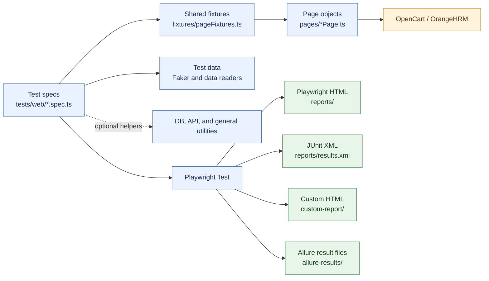
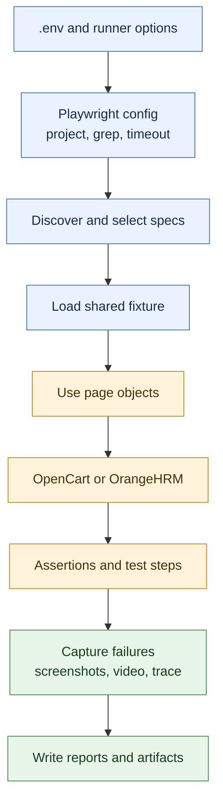

# Playwright Automation Framework

A TypeScript end-to-end testing framework built with [Playwright Test](https://playwright.dev/docs/intro). It currently covers browser-based workflows for OpenCart and OrangeHRM, with reusable page objects, fixtures, test-data helpers, and several report formats.

> **Current scope:** The checked-in test cases are web UI tests. API routes and JSON schemas, database access, and multiple data readers are available as utilities or scaffolding, but there are no API or database test cases yet.

## Table of Contents

- [Features](#features)
- [Framework Architecture](#framework-architecture)
- [Repository Structure](#repository-structure)
- [Prerequisites](#prerequisites)
- [Getting Started](#getting-started)
- [Configuration](#configuration)
- [Running Tests](#running-tests)
- [Framework Workflow](#framework-workflow)
- [Reports and Debugging](#reports-and-debugging)
- [CI/CD and Docker](#cicd-and-docker)
- [Current Limitations](#current-limitations)
- [Utilities and Extension Points](#utilities-and-extension-points)
- [Author](#author)

## Features

- Browser UI automation with Playwright Test and TypeScript.
- Page Object Model (POM) classes for OpenCart account registration and OrangeHRM login and employee workflows.
- Shared page fixtures that load application URLs from environment variables.
- Generated test data through Faker, plus JSON, CSV, and Excel readers.
- Report outputs for Playwright HTML, JUnit XML, a custom HTML dashboard, and Allure results.
- Failure diagnostics configured to capture screenshots, videos, and traces.
- GitHub Actions and Jenkins pipeline definitions, plus a Docker image and Compose service.
- API route constants, response-schema files, and a MySQL query helper for future test coverage.

## Framework Architecture

The test specifications describe the scenario. Fixtures provide configured browser pages and page objects encapsulate the UI actions. Utilities supply test data and other shared helpers. Playwright runs the tests and sends results to the configured reporters.



## Repository Structure

```text
.
├── .env.sample                  # Example environment configuration
├── .dockerignore
├── .gitignore
├── .github/workflows/
│   └── playwright.yml           # GitHub Actions workflow
├── api/
│   ├── endpoints/routes.ts      # Fake Store API route constants
│   └── schemas/                 # Product, user, and cart JSON schemas
├── fixtures/
│   └── pageFixtures.ts          # Shared Playwright page-object fixtures
├── pages/
│   ├── AccountSuccessPage.ts
│   ├── HomePage.ts
│   ├── MyAccountPage.ts
│   ├── OrangeHRM*Page.ts        # OrangeHRM login, PIM, and employee pages
│   └── RegisterPage.ts
├── prompts/                     # Web, API, database, and utility prompt templates
├── testdata/
│   ├── opencart_logindata.csv
│   ├── opencart_logindata.json
│   └── opencart_logindata.xlsx
├── tests/
│   ├── api/                     # No API specs currently
│   ├── db/                      # No database specs currently
│   └── web/
│       ├── orangehrm-add-employee.spec.ts
│       ├── orangehrm-login.spec.ts
│       └── user-registration.spec.ts
├── utils/
│   ├── CustomReporter.ts        # Custom HTML reporter
│   ├── DataReader.ts            # JSON, CSV, and Excel readers
│   ├── dataGenerator.ts         # Faker-based data and payload helpers
│   ├── dbClient.ts              # MySQL query helper
│   └── helper.ts                # Shared test helpers
├── Dockerfile
├── docker-compose.yml
├── docker-entrypoint.sh
├── env_setup.bat                # Optional Windows dependency setup helper
├── Jenkinsfile
├── package.json
├── package-lock.json
├── playwright.config.ts
├── playwright-mcp-context.md
└── tsconfig.json
```

Test runs create or update output folders: `reports/`, `custom-report/`, `allure-results/`, and `test-results/`. `allure-report/` is used when an Allure HTML report is generated separately. A local `.env` file is ignored by Git; do not commit credentials.

## Prerequisites

- Node.js LTS and npm.
- Git, to clone the repository.
- Network access to the applications under test.
- A running OpenCart instance reachable at `WEB_APP_URL` (the sample points to a local URL).
- The OrangeHRM demo or a suitable test instance and credentials for OrangeHRM tests.
- MySQL is only needed if you choose to use the database helper; no current test requires it.

The Playwright configuration enables **Chromium**. Install that browser after installing npm dependencies.

## Getting Started

Clone the repository and install dependencies from its root:

```bash
git clone https://github.com/shthousif-cloud/Playwright_Framework_v1.git
cd Playwright_Framework_v1
npm ci
npx playwright install chromium
```

Create a local environment file from the supplied template.

PowerShell:

```powershell
Copy-Item .env.sample .env
```

macOS/Linux:

```bash
cp .env.sample .env
```

Edit `.env` for your test environment. In particular, make sure `WEB_APP_URL` points to a reachable OpenCart site; the sample value is `http://localhost/opencart/upload/`. Supply valid OrangeHRM values before running OrangeHRM tests. Keep `.env` local and use your CI provider's secret store for credentials.

## Configuration

The page fixtures load `.env` and require `WEB_APP_URL`. OrangeHRM tests additionally use their application URL and login credentials. The sample file includes other settings for future API and database tests.

| Variable(s) | Purpose and current usage |
|---|---|
| `WEB_APP_URL` | Required by the shared web fixture; base URL for OpenCart tests. |
| `ORANGEHRM_APP_URL` | OrangeHRM login URL; required by the OrangeHRM fixture. |
| `ORANGEHRM_USERNAME`, `ORANGEHRM_PASSWORD` | Credentials read by the OrangeHRM test helper. |
| `DB_HOST`, `DB_PORT`, `DB_USER`, `DB_PASSWORD`, `DB_NAME` | Used by `utils/dbClient.ts` when a test calls the MySQL helper. No DB test currently calls it. |
| `TEST_ENV`, `TEST_AUTHOR` | Optional custom-reporter metadata; the reporter falls back to `QA`. Set these in the runner environment when needed. |
| `APP_ENV`, `APP_EMAIL`, `APP_PASSWORD`, `PRODUCT_NAME`, `PRODUCT_QUANTITY`, `TOTAL_PRICE`, `ADMIN_USERNAME`, `ADMIN_PASSWORD` | Present in `.env.sample`, but not read by the current tests. |
| `API_BASE_URL`, `USERNAME`, `PASSWORD`, `USER_ID`, `PRODUCT_ID`, `CART_ID`, `LIMIT`, `START_DATE`, `END_DATE` | Sample API settings; current API route constants use a fixed Fake Store API base URL and no API specs consume these variables. |
| `BASIC_AUTH_*`, `API_KEY`, `ACCESS_TOKEN`, `CLIENT_ID`, `CLIENT_SECRET`, `AUTHORIZATION_CODE`, `TOKEN_URL` | Commented examples in `.env.sample`; not currently consumed. |

Do not use production accounts for tests that create data. The current UI scenarios register an OpenCart customer and create an OrangeHRM employee.

## Running Tests

The Playwright configuration sets `testDir` to `tests`, applies the default grep filter `@master`, and enables the Chromium project. With no command-line filter, only matching tests are selected.

```bash
# See tests selected by the current default configuration
npx playwright test --list --project=chromium

# Run the default @master-tagged tests
npx playwright test --project=chromium

# Run a particular spec
npx playwright test tests/web/orangehrm-login.spec.ts --project=chromium

# Select by a tag used in the test titles
npx playwright test --project=chromium --grep "@sanity"

# Run every discovered test, overriding the default @master filter
npx playwright test --project=chromium --grep ".*"

# Open Playwright's interactive test runner
npx playwright test --ui

# Open the configured Playwright HTML report after a run
npx playwright show-report reports
```

Tests currently in `tests/web/` cover:

- OpenCart customer registration and account confirmation.
- OrangeHRM login and dashboard verification.
- OrangeHRM employee creation and profile verification.

### npm scripts

The scripts below are defined in `package.json`:

| Command | Current behavior |
|---|---|
| `npm test` | Runs `playwright test` with the configuration's `@master` filter. |
| `npm run test:web` | Runs `playwright test`; it does not add a web-only filter. |
| `npm run test:sanity` | Runs `playwright test`; it does not add a sanity-only filter. |
| `npm run test:regression` | Runs `playwright test`; it does not add a regression-only filter. |
| `npm run test:master` | Runs `playwright test`; selection comes from the configured grep. |
| `npm run test:e2e` | Runs `playwright test`; it does not add an e2e-only filter. |
| `npm run test:datadriven` | Runs `playwright test`; it does not add a data-driven filter. |
| `npm run test:api` | Passes `api` as a test path, but there are no API specs under `tests/`. |

Use `npx playwright test --grep "<tag>"` when you need explicit tag selection. Current test titles use `@master`, `@sanity`, `@regression`, and `@web`; the employee-creation scenario also uses `@end-to-end`. There are no current API or database specs, no `@datadriven` tags, and no `@e2e` tag.

## Framework Workflow

1. Configure target URLs and credentials in `.env` or the execution environment.
2. Playwright loads the test files and applies the project and grep settings.
3. A spec requests fixtures; the fixture prepares the browser page and constructs the appropriate page object.
4. The page object performs UI actions and exposes checks used by the spec.
5. Playwright records results and failure artifacts, then reporters produce their outputs.



The default test timeout is 30 seconds; the employee-creation scenario raises its timeout to 90 seconds. Local runs use zero retries and Playwright's default worker count. When `CI` is set, the configuration uses two retries and one worker. Browser capture is configured for screenshots on failure, video retained on failure, and a trace on the first retry.

## Reports and Debugging

| Output | Location | What it contains |
|---|---|---|
| Playwright HTML | `reports/index.html` | Interactive summary generated by Playwright's HTML reporter. |
| JUnit XML | `reports/results.xml` | Test results for CI systems that consume JUnit. |
| Custom HTML | `custom-report/index.html` | Redirects to the latest timestamped report; `history.html` links prior reports. The dashboard includes test status, steps, and available attachments. |
| Custom report media | `custom-report/screenshots/`, `custom-report/videos/`, `custom-report/traces/` | Attachments copied by the custom reporter when available. |
| Allure results | `allure-results/` | Raw result and attachment files written by `allure-playwright`. |
| Playwright artifacts | `test-results/` | Per-test output such as failure screenshots, videos, and traces. |

The Allure adapter writes result files; it does not itself create the Allure HTML site. To create and open that site, install the Allure CLI separately and run:

```bash
allure generate allure-results --clean -o allure-report
allure open allure-report
```

To inspect an available trace:

```bash
npx playwright show-trace path/to/trace.zip
```

## CI/CD and Docker

### GitHub Actions

`.github/workflows/playwright.yml` runs on pushes and pull requests to `master`, and can also be started manually. The manual workflow offers suite, browser, and run-mode choices. It installs dependencies and browsers, creates `.env` from `.env.sample`, runs tests, and uploads the HTML, custom, and Allure result folders as artifacts.

### Jenkins

`Jenkinsfile` defines parameters for a suite, browser, and mode. It installs dependencies and browsers, runs the selected npm script, archives reports and artifacts, publishes JUnit/Allure/HTML reports, and sends an email notification. Jenkins must have the relevant reporting and email plugins configured.

### CI pipeline

```mermaid
flowchart LR
    Trigger["Push / pull request<br/>or manual run"] --> Checkout["Checkout source"]
    Checkout --> Install["Install Node dependencies<br/>and Playwright browser"]
    Install --> Env["Provide environment<br/>configuration and secrets"]
    Env --> Execute["Run selected tests"]
    Execute --> Publish["Publish or upload<br/>reports and artifacts"]
    Publish --> Review["Review results<br/>and failure diagnostics"]

    classDef stage fill:#eaf2ff,stroke:#4b78a8,color:#172b4d;
    classDef output fill:#e8f5e9,stroke:#4b8b56,color:#193c1f;
    class Trigger,Checkout,Install,Env,Execute stage;
    class Publish,Review output;
```



### Docker

The `Dockerfile` builds a Playwright-based image; `docker-compose.yml` mounts report and test-artifact folders so outputs remain on the host. The Compose service reads `.env` and sets `CI=1`.

```bash
docker compose build
docker compose run --rm --entrypoint npx playwright-tests playwright test --project=chromium
```

The explicit entrypoint invocation above runs Playwright directly inside the service. See [Current Limitations](#current-limitations) before relying on the entrypoint's suite shortcuts or the default Compose command.

## Current Limitations

These notes reflect the checked-in configuration and tests:

- Only the Chromium project is enabled in `playwright.config.ts`; Firefox and WebKit are commented out even though the CI parameter lists offer them.
- `headless` is set to `false` in the Playwright configuration. The workflow's `headless` choice does not pass a headless override, so its label does not currently switch the browser to headless mode.
- The GitHub Actions workflow selects tags from the requested suite name. At present, `@e2e` does not match the employee test's `@end-to-end` tag; API and data-driven suites also have no matching tests.
- The npm aliases mostly invoke the same unfiltered Playwright command, so their names do not guarantee suite-specific selection. The configuration's default `@master` filter determines selection unless overridden with `--grep`.
- The Jenkins setup references `.env.example`, while the checked-in template is `.env.sample`. Configure the environment file or CI secrets explicitly for Jenkins.
- The Docker image pins Playwright `1.62.0`; `package.json` currently installs `@playwright/test` `1.64.1`. Keep the image and package versions aligned. The `all` branch in `docker-entrypoint.sh` also does not remove its suite argument before invoking Playwright, so the default Compose command should not be assumed to run the full suite.
- `API_BASE_URL` is a sample setting; `api/endpoints/routes.ts` currently hard-codes `https://fakestoreapi.com`. API routes, schemas, and a database helper are not yet exercised by checked-in API or DB test specs.

## Utilities and Extension Points

- **Page objects:** `pages/` holds UI locators and actions. Add or update a page object when a new UI workflow needs reusable behavior.
- **Fixtures:** `fixtures/pageFixtures.ts` exposes page objects as Playwright fixtures and navigates to the configured application URLs.
- **Generated data:** `utils/dataGenerator.ts` wraps Faker for names, contact details, dates, products, and sample API payloads.
- **File data:** `utils/DataReader.ts` reads JSON, CSV, and Excel data. Example files are in `testdata/`.
- **API scaffolding:** `api/endpoints/routes.ts` defines Fake Store API paths; `api/schemas/` contains product, user, and cart schema examples. `ajv` is installed for schema validation, but no current spec uses it.
- **Database helper:** `utils/dbClient.ts` connects to MySQL using `DB_*` settings and executes parameterized statements. Use parameter placeholders for values; do not interpolate untrusted values into SQL.
- **Accessibility dependency:** `@axe-core/playwright` is installed, but no current test runs accessibility checks.
- **Prompt templates:** `prompts/` contains examples for web, API, database, and utility test-design prompts; these are reference materials rather than executable tests.

## Author

**Author:** Mr. Thousif (SDET-QA)
